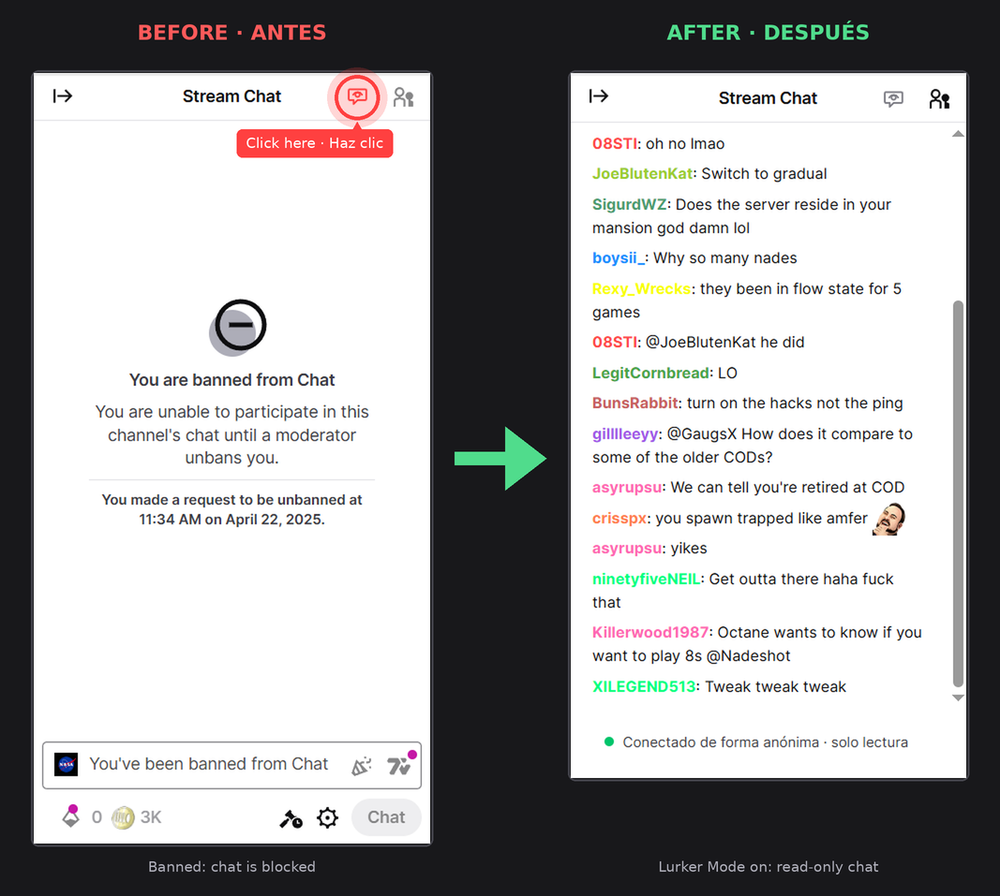

# Lurker Mode

**EN** · Read the Twitch chat of channels that have banned you, natively inside the page.
**ES** · Lee el chat de Twitch de los canales que te han baneado, de forma nativa dentro de la propia página.

Browser extension for **Chrome** and **Brave** (Manifest V3) · Extensión para **Chrome** y **Brave** (Manifest V3) · v0.1.0

> Not affiliated with, endorsed by, or sponsored by Twitch. / No está afiliada, respaldada ni patrocinada por Twitch.

---

## English

### What is it?

When a channel bans you on Twitch, you can no longer see its chat while logged in, even though people without an account can. **Lurker Mode** adds a small icon to the top of the chat box. Click it and the channel's live chat appears in the same place as the normal chat, as if you were not banned.

It is **read-only**: it does not let you write messages, and it does not evade or bypass a ban in any way. It simply lets you read what is already public.

### How it works

Twitch lets anyone read a chat anonymously through its public chat connection (the same one used by people who are not logged in). Lurker Mode opens that anonymous connection to the channel you are watching and draws the messages inside the chat column, so it looks and feels like part of Twitch.

### Features

- Icon integrated in the chat header (red = off, gray = on).
- Live chat with usernames, user colors and Twitch emotes.
- Deleted messages and timeouts are shown struck through.
- Smart auto-scroll: it pauses when you scroll up, with a button to jump back to the end.
- Automatic reconnection.
- Remembers the channels where you turned it on and reopens them next time.

### Installation

The extension is not in the Chrome Web Store yet, so it is installed manually:

1. Download this repository: **Code (green button)→ Download ZIP**.
2. Unzip it. You need the unzipped folder: browsers cannot load a ZIP directly.
3. Open `chrome://extensions` (Chrome) or `brave://extensions` (Brave).
4. Turn on **Developer mode**.
5. Click **Load unpacked** and select the folder that contains `manifest.json`.

To update: download the new version, replace the folder, and click the reload button of the extension in the extensions page.

### How to use it

1. Go to the Twitch channel that banned you (`twitch.tv/channelname`).
2. Find the small **red icon** at the top of the chat box, in the top-right corner.
3. Click it. The chat appears in place of the normal one and the icon turns **gray**.
4. Click the icon again to hide it and go back to the normal chat.

The bar at the bottom shows the connection status ("Connected anonymously · read-only").

### Limitations

- Read-only: you cannot send messages.
- No user badges and no third-party emotes (7TV, BTTV, FFZ) yet.
- Only works on channel pages (`twitch.tv/channelname`), not in pop-out chat windows.
- Twitch may change its page layout and break the icon or panel position (see Troubleshooting).

### Troubleshooting

- **The icon does not appear or is misplaced:** Twitch changed its HTML. Edit the `SELECTORS` block at the top of `content.js`.
- **The icon overlaps another button:** change the `right: 48px` value of `.tcv-btn` in `styles.css`.
- **Chat does not load:** reload the page and check your connection. If a streamer's channel is offline, there may be no messages.

### Privacy

- It connects only to Twitch's public chat server (`irc-ws.chat.twitch.tv`), anonymously, without your account or credentials.
- It stores only the list of channel names where you enabled it, locally in your browser.
- No analytics, no tracking, and no data is sent to any other server.

### Disclaimer

This extension only reads chat that Twitch already shows to anyone without an account. Please respect the streamers and communities that moderated you. Use it responsibly and follow Twitch's Terms of Service.

If this helped you, give it a ⭐
---

## Español

### ¿Qué es?

Cuando un canal te banea en Twitch, ya no puedes ver su chat con tu cuenta, aunque las personas sin cuenta sí pueden. **Lurker Mode** añade un pequeño icono en la parte superior del cuadro de chat. Al pulsarlo, el chat en vivo del canal aparece en el mismo lugar que el chat normal, como si no estuvieras baneado.

Es de **solo lectura**: no permite escribir mensajes y no evade ni salta ningún ban. Simplemente te deja leer lo que ya es público.

### Cómo funciona

Twitch permite que cualquiera lea un chat de forma anónima mediante su conexión pública de chat (la misma que usan quienes no han iniciado sesión). Lurker Mode abre esa conexión anónima al canal que estás viendo y dibuja los mensajes dentro de la columna del chat, para que se vea y se sienta como parte de Twitch.

### Características

- Icono integrado en la cabecera del chat (rojo = apagado, gris = activo).
- Chat en vivo con nombres de usuario, colores y emotes de Twitch.
- Mensajes eliminados y timeouts se muestran tachados.
- Auto-scroll inteligente: se pausa al subir, con un botón para volver al final.
- Reconexión automática.
- Recuerda los canales donde lo activaste y los abre solo la próxima vez.

### Instalación

La extensión aún no está en el Chrome Web Store, así que se instala manualmente:

1. Descarga este repositorio: **Code (boton verde) → Download ZIP**.
2. Descomprímelo. Necesitas la carpeta descomprimida: los navegadores no pueden cargar un ZIP directamente.
3. Abre `chrome://extensions` (Chrome) o `brave://extensions` (Brave).
4. Activa el **Modo de desarrollador**. (boton esquina superior derecha)
5. Pulsa **Cargar descomprimida** y elige la carpeta que contiene los archivos de la extension y `manifest.json`.

Para actualizar: descarga la nueva versión, reemplaza la carpeta y pulsa el botón de recargar de la extensión en la página de extensiones.

### Cómo usarla

1. Entra al canal de Twitch que te baneó (`twitch.tv/nombredelcanal`).
2. Busca el pequeño **icono rojo** en la parte superior del cuadro de chat, en la esquina superior derecha.
3. Púlsalo. El chat aparece en lugar del normal y el icono se vuelve **gris**.
4. Vuelve a pulsar el icono para ocultarlo y regresar al chat normal.

La barra de la parte inferior muestra el estado de la conexión ("Conectado de forma anónima · solo lectura").

### Limitaciones

- Solo lectura: no puedes enviar mensajes.
- Aún no muestra badges ni emotes de terceros (7TV, BTTV, FFZ).
- Solo funciona en páginas de canal (`twitch.tv/nombredelcanal`), no en ventanas emergentes del chat.
- Twitch puede cambiar el diseño de su página y descolocar el icono o el panel (ver Solución de problemas).

### Solución de problemas

- **El icono no aparece o está mal ubicado:** Twitch cambió su HTML. Edita el bloque `SELECTORS` al inicio de `content.js`.
- **El icono se solapa con otro botón:** cambia el valor `right: 48px` de `.tcv-btn` en `styles.css`.
- **El chat no carga:** recarga la página y revisa tu conexión. Si el canal está sin transmitir, puede que no haya mensajes.

### Privacidad

- Solo se conecta al servidor público de chat de Twitch (`irc-ws.chat.twitch.tv`), de forma anónima, sin tu cuenta ni credenciales.
- Solo guarda, de forma local en tu navegador, la lista de canales donde la activaste.
- Sin analíticas, sin rastreo, y no envía datos a ningún otro servidor.

### Aviso

Esta extensión solo lee el chat que Twitch ya muestra a cualquiera sin cuenta. Respeta a los streamers y comunidades que te moderaron. Úsala con responsabilidad y cumple los Términos de Servicio de Twitch.

Si te sirvió, dale una ⭐
---

## License / Licencia

MIT. See [LICENSE](LICENSE).
